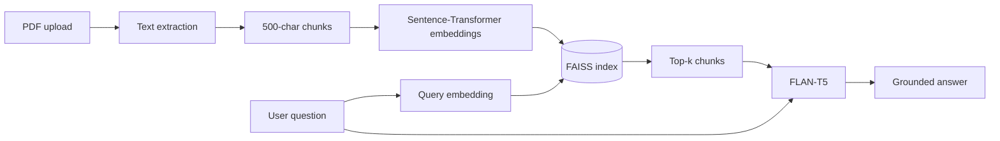
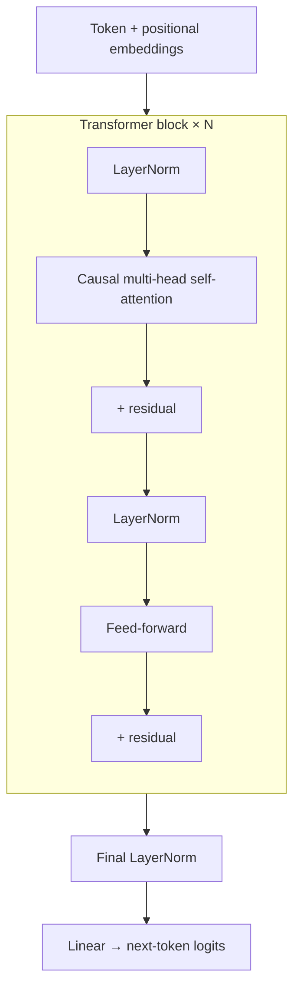

<!-- Profile README — muneer-ahmad10/muneer-ahmad10 -->

<div align="center">


<a href="https://github.com/muneer-ahmad10">
  
</a>

<br>

[](https://linkedin.com/in/muneerahmad-826363267)
[](mailto:abrard855@gmail.com)
[](https://public.tableau.com/app/profile/muneer.ahmad3580)


</div>

---

## 👨‍💻 About me

AI/ML engineer specializing in **NLP, Generative AI, RAG and semantic search**. I build and deploy AI applications with Python, PyTorch, FAISS and Sentence Transformers, and I like understanding models from the inside, which is why I implemented a **Transformer language model from scratch**.

```python
class MuneerAhmadDar:
    role      = "AI / Machine Learning Engineer"
    location  = "Srinagar, India"
    education = ["Advanced Certification in AI & ML — IIT Guwahati x Masai",
                 "BCA — Islamia College of Science & Commerce"]
    strengths = ["NLP", "RAG & semantic search", "Transformers", "Applied ML"]
    approach  = "Build it from scratch, measure it, then ship it"
    contact   = "abrard855@gmail.com"
```

---

## 📈 Highlights

<div align="center">

| 🧠 Mini GPT | 📉 Churn Recall | 🎯 Churn F1 | 🎬 Recommender | 🔍 Resume Matcher |
|:---:|:---:|:---:|:---:|:---:|
| **1.6375**<br>validation loss | **0.49 → 0.60**<br>+22% relative | **0.65**<br>Gradient Boosting | **0.84 RMSE**<br>0.78 precision | **90%**<br>on 15 test pairs |

</div>

---

## 🚀 Featured projects

<table>
<tr>
<td width="50%" valign="top">

### 📚 [PDF RAG Chatbot](https://github.com/muneer-ahmad10/Chatbot)
Upload any PDF and ask questions in plain English. Answers are generated only from retrieved chunks, keeping responses grounded in your document.

- 500-char chunking → embeddings → FAISS retrieval → FLAN-T5 generation
- Live Streamlit app with cached models

   

</td>
<td width="50%" valign="top">

### 🔍 [AI Resume Analyzer](https://github.com/muneer-ahmad10/Resume-Analyzer)
Semantic resume-job matcher that understands context, not just keywords. Shows matched and missing skills and gives learning recommendations.

- PDF parsing → skill extraction → embeddings → cosine similarity → verdict
- 90% correct on a 15-pair evaluation

   

</td>
</tr>
<tr>
<td width="50%" valign="top">

### 🧠 [Mini GPT: Transformer from Scratch](https://github.com/muneer-ahmad10/mini-gpt-pytorch)
Decoder-only Transformer built in PyTorch with no high-level model libraries: causal multi-head self-attention, positional embeddings, residual connections and LayerNorm.

- Trained on Tiny Shakespeare (1.1M characters), validation loss **1.6375**
- Autoregressive generation with temperature and top-k sampling

  

</td>
<td width="50%" valign="top">

### 📉 [Customer Churn Prediction](https://github.com/muneer-ahmad10/Customer-Churn-Prediction)
Compared Logistic Regression, Random Forest and Gradient Boosting. Fixed class imbalance with class weighting and threshold tuning.

- Recall improved **0.49 → 0.60**, best F1 **0.65**
- Evaluated with precision, recall, F1, confusion matrix and ROC-AUC

  

</td>
</tr>
<tr>
<td width="50%" valign="top">

### 🎬 [Recommendation System](https://github.com/muneer-ahmad10/Recommendation-System)
User-based and item-based collaborative filtering with cosine similarity, rating normalization and user-centering to reduce sparsity bias. Generates top-5 movie recommendations.

- RMSE **0.84**, item-based precision **0.78**

  

</td>
<td width="50%" valign="top">

### 📖 [NLP Learning Journey](https://github.com/muneer-ahmad10/Natural-Language-processing)
My day-by-day path through NLP, with 50+ commits: preprocessing → RNN → LSTM → Attention → Transformers → Mini GPT.

- Every concept implemented in code, not just read about

  

</td>
</tr>
</table>

---

## 🏗️ Under the hood

<details>
<summary><b>📚 How my RAG chatbot works</b> (click to expand)</summary>



</details>

<details>
<summary><b>🧠 How my Mini GPT is built</b> (click to expand)</summary>



</details>

---

## 🛠️ Tech stack

<div align="center">


</div>

---

## 🤝 Let's connect

I'm open to **Applied AI, Machine Learning and Generative AI** roles. If you're building with NLP or RAG, I'd love to talk.

<div align="center">

[](https://linkedin.com/in/muneerahmad-826363267)
[](mailto:abrard855@gmail.com)

*"Understand it deeply, build it from scratch, then ship it."*


</div>
